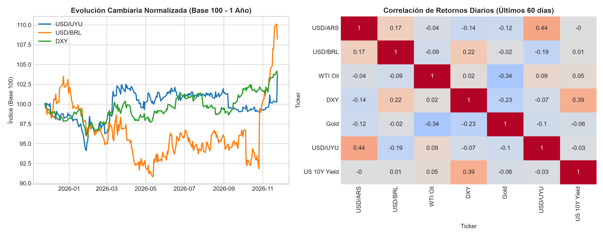

# 🌎 Tablero Macroeconómico Regional (Uruguay / LatAm)

Pipeline automatizado en Python que monitorea diariamente las principales variables cambiarias, tasas de referencia y commodities con impacto en Uruguay y la región.

*Última actualización automática: **2026-11-24 15:15 UTC***

## 📊 Resumen de Mercado
| Activo       |   Último |   Var 1D (%) |   Var 5D (%) |   YTD (%) |
|:-------------|---------:|-------------:|-------------:|----------:|
| USD/ARS      |  1590    |         1.35 |         2.59 |      9.67 |
| USD/BRL      |     5.85 |        -1.71 |         1.1  |      5.97 |
| WTI Oil      |    81.21 |         1.3  |        -5.58 |     41.68 |
| DXY          |   103.83 |        -0.47 |         0.33 |      5.49 |
| Gold         |  3611.6  |        -1.09 |        -6.54 |    -16.58 |
| USD/UYU      |    40.72 |         3.56 |         3.58 |      5.29 |
| US 10Y Yield |     4.91 |        -0.08 |        -3.7  |     17.36 |

## 📈 Tendencia Cambiaria y Correlaciones

---
*Desarrollado con Python (`yfinance`, `pandas`, `matplotlib`, `seaborn`) y automatizado mediante GitHub Actions.*
